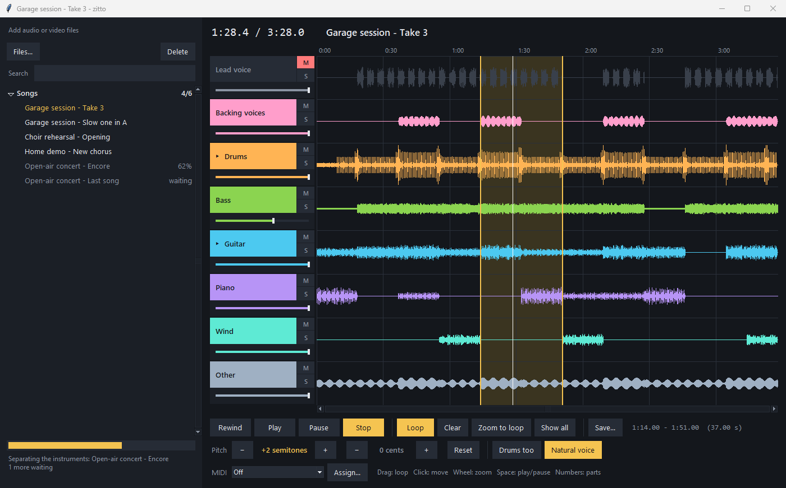
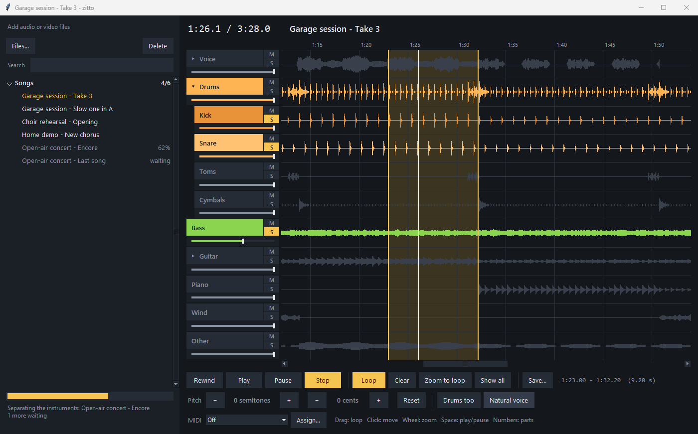

# zitto

Separates songs into their parts, plays them with each part switched on and off live, and
saves the song with the parts you want. Everything runs on your computer, on the NVIDIA GPU when
there is one. For Windows, and for a [Mac](#mac) with Apple Silicon.
*Zitto* is Italian for "hush".

Use it with recordings that you made, or that you have the right to use in this way. What you
do with the result is your responsibility: see [Terms](#terms).

## Install

On Windows it needs Python 3.12 in `C:\Python312` and ffmpeg on the PATH. Then run once:

    .\setup.bat

### Mac

It needs Apple Silicon (M1 or newer), macOS 14 or newer, and 5 GB free, or 3 without the optional
[models](#how-it-works). Each version is tested automatically on macOS 15 and 26, on virtual Macs
without a GPU. It has been used on few real ones so far: if something is not right, please
[open an issue](https://github.com/danmigdev/zitto/issues).

1. Download the dmg from the [latest release](https://github.com/danmigdev/zitto/releases/latest),
   open it, and drag zitto onto Applications
2. Open it. It has no paid certificate of Apple, so the first time macOS says that it could not
   verify it. Choose Done, then System Settings, Privacy & Security, and at the bottom **Open Anyway**
3. The first time it asks which models to have, and downloads them by itself with what else it
   needs (Python, the libraries, ffmpeg): from 1.1 to 3.5 GB. Then it opens. If you quit in the
   middle, the next time it goes on

To add or remove models later: Settings, in the zitto menu. Use Cmd where this page says Ctrl. Everything, songs included, is in
`~/Library/Application Support/zitto`: to remove zitto, delete that folder and the app. The command
line is `/Applications/zitto.app/Contents/MacOS/zitto`.

To run it from the source instead, with [Homebrew](https://brew.sh), in a terminal:

    xcode-select --install
    brew install python@3.12 python-tk@3.12 ffmpeg
    git clone https://github.com/danmigdev/zitto
    cd zitto
    ./setup.sh

Then open `window.command`. `mac/build.sh` builds the dmg.

## Use

Double-click `window.bat`.

1. **Files...** adds songs to the list on the left. They are separated one after the other, in
   the background.
2. **Double-click** a song that is ready to open it. One that is still waiting goes to the
   front of the queue, and opens when it is ready.
3. **Play** it, switching parts on and off, with a loop if you like.
4. **Save...** writes the song as you hear it: parts that are on, at their volumes.

Each song is separated only once. Close the window whenever you like: at the next start the
last song is there as you left it, with its parts, volumes and loop, and what was still
waiting goes on.

The parts: lead voice, backing voices, drums, bass, guitar, piano, wind, other. The drums open
into kick, snare, toms and cymbals. All of them together are the original.

### Player

| To | Do |
| --- | --- |
| mute a part | M, or click its name, or its number on the keyboard |
| hear only some | S (solo); a muted part stays silent also when soloed |
| set its volume | drag the line under its name |
| open the drums into their pieces | the arrow beside their name; mute and volume of the drums act on all the pieces |
| select a loop | drag on the waveform, then drag its edges to adjust |
| move | click on the waveform |
| zoom, scroll | wheel, Shift+wheel |
| play/pause, rewind, loop on/off, clear loop, save | Space, Home, L, Esc, Ctrl+S |

Stop and Rewind go back to the start of the loop, or of the song when there is no loop.

### MIDI

Choose the device at the bottom. Play, Pause, Stop and Rewind respond to:

- standard transport messages, with no setup: MMC, and Start/Continue/Stop
- any note, control change or program change: press **Assign...**, **Learn**, then the button

Pause pressed again resumes. Windows usually lets one program at a time use a MIDI input:
close others that hold the device.

### List

- Songs are listed as "Artist - Title", from the tags of the file, or with the name of the
  file. Right-click, Rename, to change it
- Search (Ctrl+F) looks for all the words, anywhere in the name, ignoring accents and
  capitals. Enter opens the first song found, Esc shows everything again
- A song that failed is in red: select it to read why, right-click to try again
- Delete removes songs from the library, never your own files or what you saved

## Command line

For removing something without opening the window. The result goes to `output\`:

    .\zitto.exe song.mp3                     remove the voice
    .\zitto.exe song.mp3 -r drums bass       remove drums and bass
    .\zitto.exe song.mp3 -o result.flac
    .\zitto.exe song.mp3 --player            open the window with this song

Names (Italian ones too): `voice`, `lead-voice`, `drums`, `bass`, `guitar`, `piano`, `wind`,
`other`.

## How it works

Four models estimate the parts; what none of them recognises stays in "other". They are not
part of zitto: each is downloaded to `models\` the first time it is needed. (The app for the Mac
downloads those that you choose the first time it is opened.)

| Model | Used for | Size | Terms |
| --- | --- | --- | --- |
| [BS-Roformer-SW](https://huggingface.co/enerjazzer/BS-ROFO-SW-Fixed) | voice, drums, bass, guitar, piano | 0.7 GB | **unknown** |
| [Mel-Roformer Karaoke (becruily)](https://huggingface.co/becruily/mel-band-roformer-karaoke) | lead and backing voices | 1.7 GB | **not stated** |
| [MDX23C DrumSep (aufr33, jarredou)](https://pypi.org/project/mdxnet-infer/) | kick, snare, toms, cymbals | 0.4 GB | **not stated** |
| [UVR 17_HP-Wind_Inst](https://github.com/Anjok07/ultimatevocalremovergui) | wind | 0.2 GB | MIT, with credit to UVR |

The first is always needed. To do without the others write, in `settings.json`,
`"without": ["lead", "drums", "wind"]`, or only some of them: the voice stays one part, the drums
stay one part, wind stays in "other". The app for the Mac asks it.

The first three were chosen for their quality, but how they can be used is not known: the author
of the first is unknown, those of the others do not say. Decide for yourself whether
to use them. To have only models whose authors state their terms, set the environment variable
`ZITTO_MODELS` to `stated`. The quality is lower, guitar and piano stay in "other", and the drums
are one part:

| Model | Used for | Size | Terms |
| --- | --- | --- | --- |
| [UVR-MDX-NET Main](https://github.com/Anjok07/ultimatevocalremovergui) | voice | 0.1 GB | MIT, with credit to UVR |
| [Open-Unmix UMX-L](https://zenodo.org/records/5069601) | drums, bass | 0.5 GB | CC BY-NC-SA 4.0 |
| [UVR 6_HP-Karaoke](https://github.com/Anjok07/ultimatevocalremovergui) | lead and backing voices | 0.1 GB | MIT, with credit to UVR |
| [UVR 17_HP-Wind_Inst](https://github.com/Anjok07/ultimatevocalremovergui) | wind | 0.2 GB | MIT, with credit to UVR |

The separation is an estimate: traces of a part can remain in the others, and instruments
that sound alike (two guitars, for example) cannot be told apart.

Songs are kept in `library\`, about 20 MB per minute. To keep them elsewhere, set the
environment variable `ZITTO_LIBRARY` to a folder.

Plugins can add places to open songs from, or other models: see [docs/PLUGINS.md](docs/PLUGINS.md).

## Tests

    .venv\Scripts\python.exe -m pip install pytest
    .venv\Scripts\python.exe -m pytest

## Terms

zitto is under the [PolyForm Noncommercial License 1.0.0](LICENSE.md): you can use, change and
share it for any non-commercial purpose. Selling it, or using it commercially, is not allowed.
The source is available, but this is not an "open source" licence as the OSI defines it, since
those cannot forbid selling.

The models and the libraries that are downloaded have terms of their own, listed in
[NOTICE.md](NOTICE.md). Those of three models are not known, and some are for non-commercial
use only.

Separating a song does not give any right on it. Copying, publishing or performing a recording
made by others, or part of it, usually needs the permission of who holds its rights.
